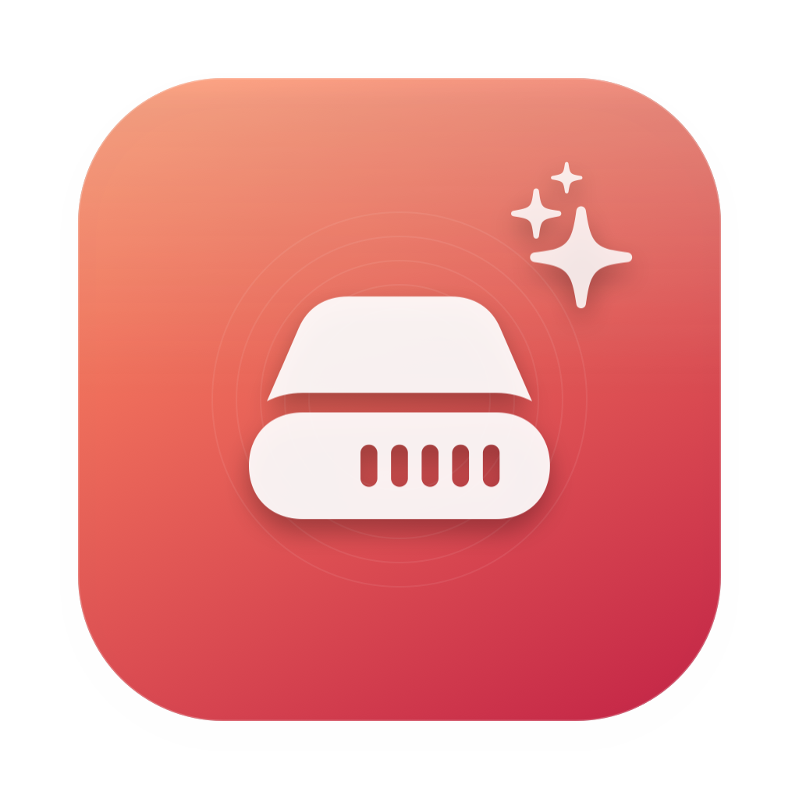
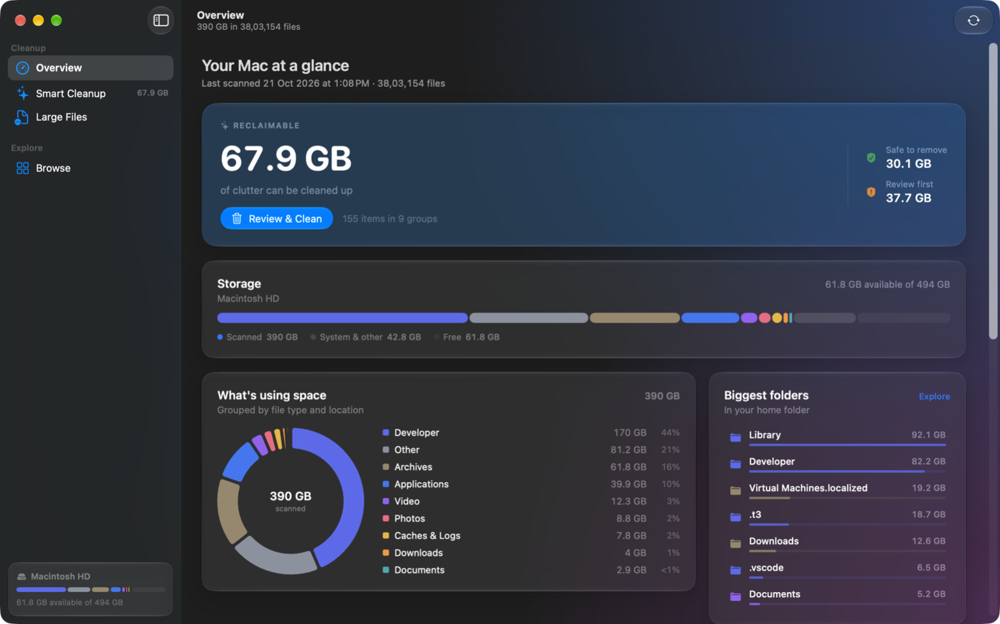
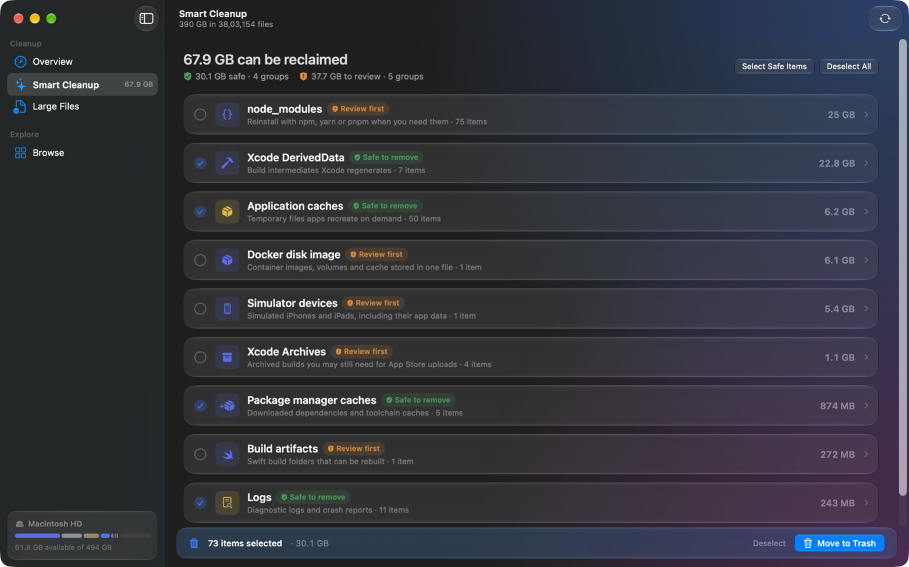
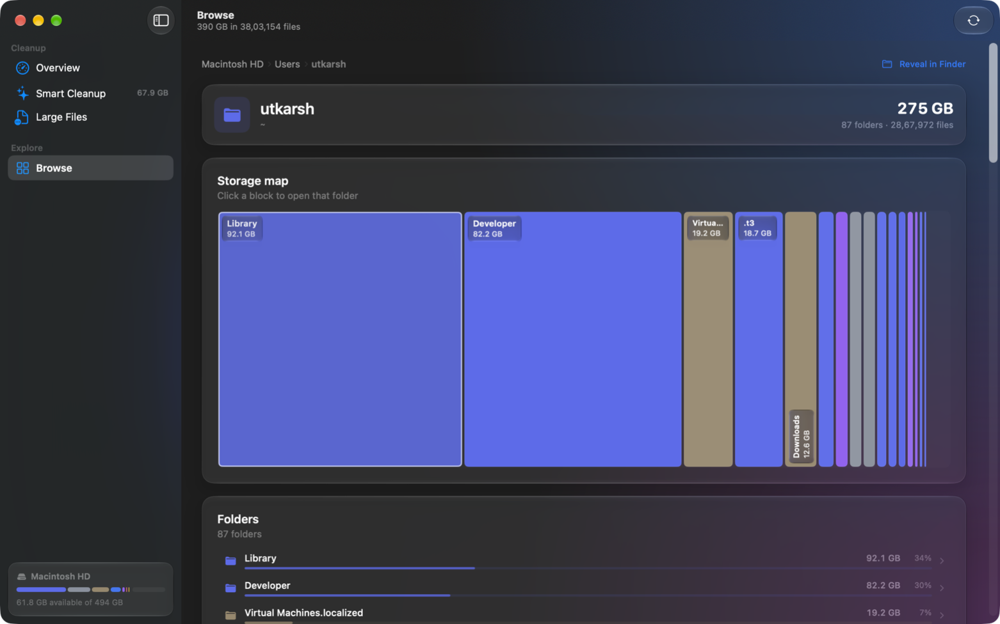
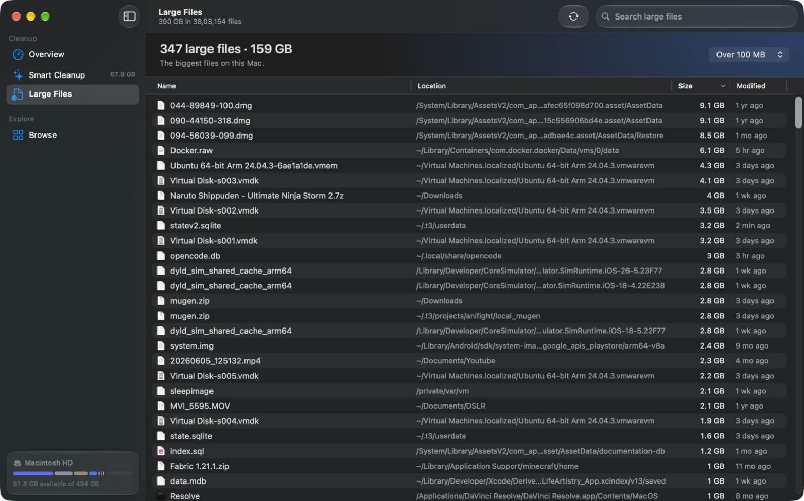
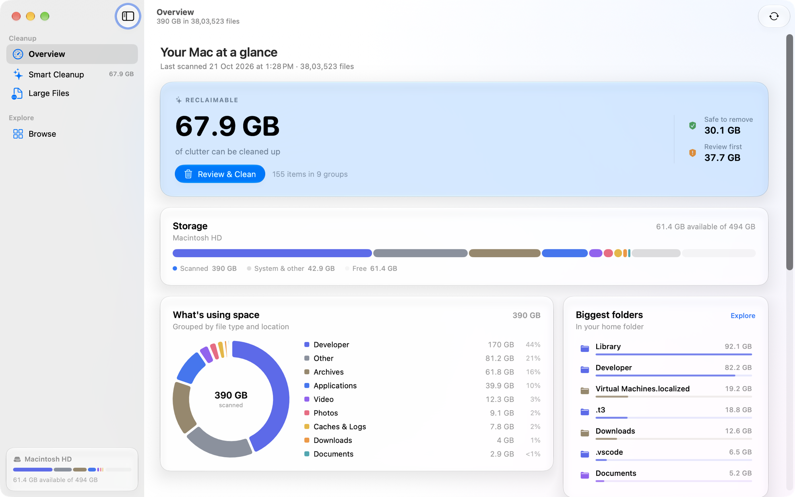
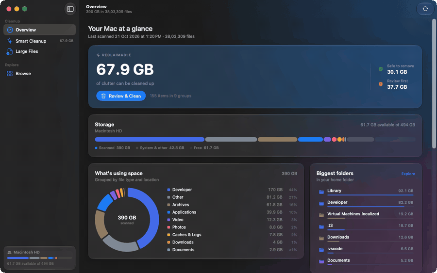

<div align="center">



# SpaceCrunch

**See what's eating your disk. Reclaim it in a couple of clicks.**

A native macOS storage scanner with a Liquid Glass interface. It maps your
whole boot volume, tells you exactly what is taking up space, finds the junk
worth throwing away, and removes it safely.

[](https://www.apple.com/macos/)
[](https://swift.org)
[](LICENSE)
[](https://github.com/UtkarshDeoli/space-crunch/releases)

[⬇️ Download the latest release](https://github.com/UtkarshDeoli/space-crunch/releases/latest)

</div>

---

## The problem

You know your Mac is full. You don't know **what** is full.

`du -sh` tells you a folder is 92 GB, and then you're twenty `cd`s deep,
running `du` again, guessing which of the four `node_modules` folders is the
culprit. macOS Storage Management tells you "Documents: 40 GB" — which is
useless, because Documents is where your code, your videos, and your tax
receipts all live together.

SpaceCrunch answers the question directly: **here is your disk, drawn to
scale, coloured by what actually fills it.**

<div align="center">
  
</div>

---

## What it does

### 🗺️ Maps your entire disk

Scans the whole boot volume — every real top-level folder from `/`, including
your home folder, `/Applications`, `/Library`, `/System` and `/private` — and
builds a full folder tree with allocated sizes. Firmlinked paths and mounted
disks are skipped, so no byte is ever counted twice.

A **squarified treemap** renders that tree. Click any block to drill into it,
folder by folder, without rescanning. The map is the fastest way to find the
one folder that doesn't belong.

### 🎨 Colours folders by what they *actually* contain

A folder's name rarely says what's inside it. `~/Developer` is source code by
convention, but `~/Library` is just wherever 200 apps happen to keep their
data. So SpaceCrunch tallies the bytes in every category as it walks the tree,
rolls those tallies up through the tree, and colours each folder by the
category that holds most of its bytes.

The result: a blue block really is 12 GB of video, not "some folder called
Downloads".

### 🧹 Finds cleanup opportunities

Nine groups of things worth throwing away, found automatically:

| Group | What it is | Risk |
| --- | --- | --- |
| **Xcode DerivedData** | Build intermediates Xcode regenerates | ✅ Safe |
| **Application caches** | Temporary files apps recreate on demand | ✅ Safe |
| **Package manager caches** | Homebrew, npm, Yarn, pnpm, Gradle, Maven, Cargo | ✅ Safe |
| **Logs** | Diagnostic logs and crash reports | ✅ Safe |
| **`node_modules`** | Reinstall with npm, yarn or pnpm | ⚠️ Review |
| **Docker disk image** | Container images, volumes and cache in one file | ⚠️ Review |
| **Simulator devices** | Simulated iPhones and iPads, including their app data | ⚠️ Review |
| **Xcode Archives** | Archived builds for App Store uploads | ⚠️ Review |
| **Build artifacts** | Swift `.build` folders that can be rebuilt | ⚠️ Review |

Also on the list: old installers in Downloads and the Trash itself.

**Safe to remove** groups are pre-selected. **Review first** groups need an
explicit choice, because they're safe to remove but you'll want to download or
rebuild them afterwards.

### 📄 Lists large files

Every file over the threshold, with native Finder icons, sortable by size or
date, multi-selectable, and one click to Reveal in Finder.

### 🗑️ Deletes safely, reversibly

Selected items move to the **Trash**, so everything is reversible. Only items
already in the Trash are deleted permanently, and every deletion requires a
confirmation.

---

## Screenshots

<div align="center">

### Smart Cleanup



### Browse — a live treemap of your disk



### Large Files



### Light appearance



</div>

### The tour

<div align="center">
  
</div>

---

## Installing

### From a release (recommended)

1. Download the `.dmg` from the [releases page](https://github.com/UtkarshDeoli/space-crunch/releases/latest).
2. Open it and drag **SpaceCrunch** into **Applications**.
3. Launch it from Spotlight or Applications.

> **First launch?** The release build is ad-hoc signed, because signing and
> notarizing for distribution requires a paid
> [Apple Developer Program](https://developer.apple.com/programs/) membership.
> macOS will show *"SpaceCrunch cannot be opened because it is from an
> unidentified developer."* Right-click the app in **Applications** →
> **Open** → **Open** to approve it once. After that it launches normally.
>
> If you'd rather not do that, [build it from source](#build-and-run) — it
> runs from wherever you put it, no Gatekeeper prompt.

### From source

```bash
git clone https://github.com/UtkarshDeoli/space-crunch.git
cd space-crunch
scripts/build_app.sh
open dist/SpaceCrunch.app
```

---

## First run

SpaceCrunch scans your whole disk on launch. On a modern Mac that takes a
minute or two; the progress bar and the live file count are in the toolbar.

Then:

- **Overview** shows the reclaimable total, the storage bar, a category
  breakdown, your biggest folders, and a clickable storage map.
- **Smart Cleanup** lists every group worth clearing, with the safe ones
  already ticked. Hit **Move to Trash**.
- **Large Files** shows the individual files taking up the most room.
- **Browse** maps your disk as a treemap you can click through.

### Full Disk Access (optional, recommended)

Some folders macOS protects are skipped until the app is granted Full Disk
Access:

1. Open **System Settings → Privacy & Security → Full Disk Access**.
2. Add `SpaceCrunch.app` from the Applications folder.
3. Relaunch and press `⌘R` to rescan.

The Overview screen shows a shortcut to these settings whenever the scan hits
locations it can't read.

> Without this permission macOS doesn't *refuse* the folder — it parks the
> `open` call waiting for consent that never arrives, so the scan appears to
> hang. SpaceCrunch works around this: it opens each directory *relative* to
> its parent, which turns that endless wait into a bounded five-second
> timeout per protected folder. The folder is then skipped and counted as a
> permission problem, so a full-disk scan still finishes in a few minutes
> without the grant. With the grant, protected folders are included too.

---

## Keyboard shortcuts

| Action | Shortcut |
| --- | --- |
| Scan now / rescan | `⌘R` |
| Cancel scan | `⌘.` |

---

## Design

SpaceCrunch is built on macOS 26's **Liquid Glass** design language — the same
material system Apple ships in the latest macOS.

- Cards, the volume badge, the action bars, the toast and the treemap labels
  are **glass panels** (`glassEffect`) — translucent, refractive, and borderless
  apart from their own specular highlight.
- One `GlassEffectContainer` gathers the detail column's panels so they share a
  single backdrop sample and read as parts of one surface rather than separate
  frosted rectangles. It stops short of the title bar on purpose: a container
  that reaches into the toolbar pulls the toolbar's items into its shared glass
  layer, which composites them over the toolbar's labels and turns the rescan
  and sidebar-toggle glyphs into pale ghosts.
- Buttons use Apple's glass styles: `.glass` for secondary actions and
  `.glassProminent` for the one primary action on a screen.
- Behind the detail column sits a soft **colour wash** (`AppBackground`). Glass
  needs something to bend — on a flat window background every panel would read
  as a plain rounded rectangle. The wash sits in the detail column so the
  sidebar keeps the system's own material, the way a native split view looks.
- Scroll views use `.scrollEdgeEffectStyle(.soft, for: .top)` so content
  softens as it passes under the title bar. The title and subtitle are drawn
  by the real title bar rather than by a view in the content — with the title
  drawn into the content layer, the title bar's glass smeared it into an
  unreadable blur.
- `.backgroundExtensionEffect()` is deliberately *not* used. It extends the
  content's background into the title bar, but it also blurred the title and
  subtitle into a second, ghost copy beside the real one.
- Type follows the macOS type scale (`AppFont`), and controls use the standard
  corner radius and control sizes.

The result follows your system's accent colour and appearance. The one place
the two differ is the background wash: light mode composites it normally at a
fraction of the opacity, because additive blending on a white background turns
the wash into pastel milk.

---

## Safety and privacy

- **Nothing is deleted without a confirmation alert.**
- Normal cleanup uses `FileManager.trashItem`, so you can restore anything from
  the Finder's Trash.
- Permanent deletion is limited to items that already live in `~/.Trash`.
- The app is **not sandboxed** — a storage scanner needs broad file access. It
  only reads *metadata*: names, sizes and dates. **File contents are never
  read, uploaded, or inspected.**
- SpaceCrunch makes no network requests. There is no telemetry, no analytics,
  and no account. It works entirely offline.

---

## Requirements

- **macOS 26 or newer.** The UI is built on Apple's Liquid Glass APIs
  (`glassEffect`, `GlassEffectContainer`, `scrollEdgeEffectStyle`), which are
  what give the app its current look. It won't launch on earlier systems.
- **Xcode 26+** (Swift 6.2 toolchain). The package manifest needs
  `swift-tools-version: 6.2` to target `.macOS(.v26)`.

---

## Build and run

```bash
# Development run
swift run SpaceCrunch

# Build a double-clickable, ad-hoc signed app bundle
scripts/build_app.sh

# Build and launch
scripts/build_app.sh --open
```

The app bundle is written to `dist/SpaceCrunch.app`. The build script also
generates the app icon from `scripts/make_icon.swift`.

### Building a DMG

```bash
scripts/build_app.sh
scripts/make_dmg.sh          # writes dist/SpaceCrunch-1.0.dmg
```

### Signing with a stable identity

The build script signs ad-hoc by default. That works, but macOS keys its Full
Disk Access grant to the code signature, and an ad-hoc signature changes with
every build — so macOS silently drops the permission after a rebuild. To keep
it across rebuilds, sign with a stable identity:

```sh
SPACECRUNCH_SIGN_IDENTITY="Apple Development: you@example.com (TEAMID)" scripts/build_app.sh
```

> Signing with a real identity opens a keychain prompt, so it has to stay
> opt-in rather than happen on every build.

---

## Tests

```bash
swift test
```

Coverage includes treemap geometry, file classification, size formatting,
scanner output (categories, cleanup groups, deletion updates), content-based
folder colouring, and permanent deletion from the Trash.

---

## Project layout

```
Sources/SpaceCrunchCore/   Scanning, classification, cleanup rules, deletion, models
Sources/SpaceCrunch/       SwiftUI app, views, theme, app model
Tests/                     Core test suite
scripts/build_app.sh       Release build + .app packaging + ad-hoc signing
scripts/make_dmg.sh        Packages the app into a distributable DMG
scripts/make_icon.swift    Renders the app icon
scripts/make_gif.sh        Assembles captured frames into a GIF
```

### Development screenshots

The app can photograph its own window to PNGs without Screen Recording
permission:

```bash
open -a "$PWD/dist/SpaceCrunch.app" --args --capture-dir /tmp/spacecrunch-shots
```

Launch it through LaunchServices (`open -a`) rather than running the binary
directly: a window that isn't key renders its accent-coloured controls in grey,
so the captures wouldn't show the real colours. The capture goes through the
window server, because only the window server can resolve the backdrop
sampling that Liquid Glass depends on — `cacheDisplay` draws glass as a flat
fill.

Useful flags: `--home /path/to/fixture` scans a test directory instead of your
real home folder, `--appearance light|dark` forces an appearance, and
`--window-size 1180x760` sets the window size.

### Development GIFs

`--demo-dir` runs a scripted tour of the app, capturing a frame at every step
and writing a manifest of how long each frame should be held:

```bash
open -a "$PWD/dist/SpaceCrunch.app" --args --demo-dir /tmp/spacecrunch-demo
scripts/make_gif.sh /tmp/spacecrunch-demo/frames docs/gifs/tour.gif
```

---

## Contributing

Issues and pull requests are welcome. Please run `swift test` before opening a
PR.

---

## License

[MIT](LICENSE) © 2026 Utkarsh Deoli
